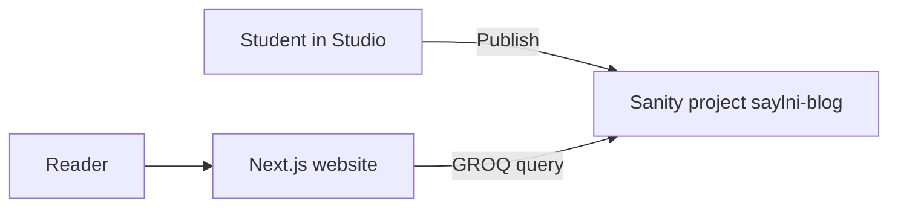

# Saylani Tech Blog

A simple blog for students. You write posts in Sanity Studio. The website shows them after you press Publish.

- Website name: **Saylani Tech Blog**
- Sanity project name: **saylni-blog**
- Project ID: `o2zj2owv`
- Dataset: `production`

The student handout is [docs/Saylani-Tech-Blog-Student-Guide.pdf](docs/Saylani-Tech-Blog-Student-Guide.pdf). It covers the basic ideas, how to install Sanity, the folder structure, and how Next.js connects to the project. The lesson notes are in `docs/`.

## What the site can do

- Home page lists published posts
- `/blog` lists the same posts
- `/blog/[slug]` shows one post
- `/about` explains the blog
- `/studio` is the editor
- If nothing is published, the page says so. It does not invent posts.

There is one content type: **Post**. A post has a title, slug, short summary, cover image, date, and body.

## Tech stack

- Next.js 16, App Router, JavaScript only
- React 19
- Tailwind CSS 4
- shadcn/ui
- Sanity and `next-sanity`
- GROQ and Portable Text

## How the pieces connect



A draft stays in Studio. The public site only asks for published posts.

## Folder map

```text
src/app/(site)/page.js          home page
src/app/(site)/blog/page.js     post list
src/app/(site)/blog/[slug]/page.js   one post
src/app/studio/                 Sanity Studio
src/sanity/schemas/post.js      the only schema
src/sanity/lib/queries.js       GROQ questions
src/sanity/lib/posts.js         functions the pages call
docs/                           lesson notes and the PDF
```

## What you need

- Node.js 20 or newer
- npm
- A Sanity account that can open the project **saylni-blog**

## Run the website

```bash
npm install
npm run dev
```

Open [http://localhost:3000](http://localhost:3000).

The file `.env.local` already has the class project ID:

```text
NEXT_PUBLIC_SANITY_PROJECT_ID=o2zj2owv
NEXT_PUBLIC_SANITY_DATASET=production
NEXT_PUBLIC_SANITY_API_VERSION=2026-10-17
NEXT_PUBLIC_SITE_URL=http://localhost:3000
```

If `.env.local` is missing, copy `.env.example`. Restart `npm run dev` after you change that file.

The project ID is public. It is not a password. Do not put a write token in a `NEXT_PUBLIC_` variable.

## Open the editor

Open [http://localhost:3000/studio](http://localhost:3000/studio) and sign in.

The first time, Sanity may say the Studio is not connected. That means this computer is not allowed yet.

1. Sign in at [sanity.io/manage](https://www.sanity.io/manage).
2. Open project **saylni-blog**.
3. Add the CORS origin `http://localhost:3000`.
4. Turn on **Allow credentials**.
5. Save, then refresh `/studio`.

## Publish a post

1. In Studio, open **Posts** and create a post.
2. Fill in the title.
3. Click **Generate** next to the slug.
4. Add a short summary, a cover image, and some body text.
5. Click **Publish**. Save is not enough.
6. Refresh [http://localhost:3000](http://localhost:3000).

On your computer, a refresh shows the new post right away. A deployed site can take about a minute, because production pages are cached.

## Lesson notes

| Lesson | What you learn |
| --- | --- |
| [00 Overview](docs/00-course-overview.md) | What the class builds |
| [01 Headless CMS](docs/01-headless-cms-fundamentals.md) | Why the writing is not inside the React files |
| [02 Setup](docs/02-project-setup.md) | Install Sanity, folders, and the Next.js connection |
| [03 Sanity project](docs/03-sanity-account-and-project.md) | Project ID, dataset, and Studio login |
| [04 Schema](docs/04-schemas-and-content-modeling.md) | The post fields |
| [05 GROQ](docs/05-groq-and-data-fetching.md) | How the page asks for posts |
| [06 Images and text](docs/06-sanity-images-and-portable-text.md) | Pictures and the article body |
| [07 The pages](docs/07-building-the-editorial-ui.md) | How the simple pages are built |
| [08 Routes](docs/08-routing-search-and-categories.md) | Slugs and missing pages |
| [09 Go live](docs/09-deployment-and-production.md) | Deploy, cache, and the free plan |
| [10 Exercises](docs/10-classroom-exercises-and-solutions.md) | Practice and answers |
| [11 For the teacher](docs/11-instructor-guide.md) | Class plan |

## Common problems

| What you see | What to try |
| --- | --- |
| No posts yet, but you clicked Save | Click **Publish**, then refresh the site. |
| Studio says it is not connected | Add `http://localhost:3000` as a CORS origin and allow credentials. |
| `node` is not recognized | Install Node.js, then open a new terminal. |
| You changed `.env.local` and nothing happened | Stop the server and run `npm run dev` again. |

## Security

- Do not commit `.env.local`.
- Do not put a Sanity write token in the project.
- Studio is protected by the Sanity login, not by hiding the URL.

## Free plan

Sanity’s free plan is enough for this class. Limits can change. Check [sanity.io/pricing](https://www.sanity.io/pricing) before a public launch. This blog only reads published posts. It does not need a paid plan.
