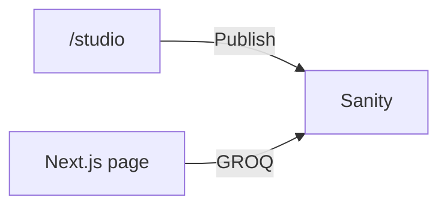

# Course overview

## What this class is

You will run Saylani Tech Blog and publish a real post. The website is Next.js. The writing lives in Sanity, in the project **saylni-blog**. The project ID is `o2zj2owv`.

You do not need to know a CMS before you start. You should already know basic HTML, CSS, and JavaScript.

## Why we do it this way

If the post text is pasted into a React file, only a programmer can change it. With Sanity, a student opens Studio, edits the post, and presses Publish. The website reads that post and shows it.

## What you will make

- A home page that lists posts
- A post page at `/blog/your-slug`
- An about page
- The editor at `/studio`

There is one schema: `post`. We are not using separate author or category types in this version. That keeps the first lessons small.

## The path

## Lessons

1. What a headless CMS is
2. How to start this project
3. The Sanity account and Studio
4. The post schema
5. GROQ and loading data
6. Images and the article body
7. The pages you see
8. Slugs and missing pages
9. Putting the site online
10. Exercises
11. Notes for the teacher

## Files you will open often

- `src/sanity/schemas/post.js`
- `src/sanity/lib/queries.js`
- `src/app/(site)/page.js`
- `src/app/(site)/blog/[slug]/page.js`

## A mistake to avoid

Clicking **Save** in Studio and expecting the website to change. The public site shows a post only after **Publish**.

## Try this

Open `http://localhost:3000` and `http://localhost:3000/studio`. Write one sentence about which page is for readers and which page is for editors.

## Questions

- Where is the blog text stored?
- What is the difference between the project name `saylni-blog` and the project ID `o2zj2owv`?
- Why does an empty site say “No posts yet” instead of showing a fake article?

## You can say you learned it when

You can point to the reader pages and the Studio page, and you can explain that published posts come from Sanity.
