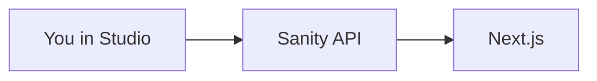

# What a headless CMS is

## The idea

A CMS is the place where you edit content. CMS means content management system.

A traditional CMS stores the writing and also draws the public website. A headless CMS stores the writing and sends it to another app through an API. This class uses Sanity as the CMS and Next.js as the website.

## Words you will hear

- **Frontend.** The pages a reader sees.
- **Backend.** The place that stores the posts. Here, that is Sanity.
- **API.** A door programs use. The website asks a question and gets JSON back.
- **Structured content.** A post is split into fields: title, slug, summary, image, date, and body. It is not one blob of HTML.
- **GROQ.** Sanity’s question language. It is not REST and it is not GraphQL, but the idea is the same: ask for the fields you need.

## Why this helps

- An editor can change a sentence without editing React.
- The homepage can show the title and summary without loading the whole article.
- The same post could later be used by another app.

## The cost

You have to describe the fields, write the query, and connect two systems. A new post on a deployed site can take about a minute to appear because of caching. On your own computer, a refresh is enough.

## How a post moves

1. You create a post in `/studio`.
2. You press Publish.
3. A reader opens `/`.
4. `src/app/(site)/page.js` calls `getPosts()`.
5. That function runs the GROQ in `src/sanity/lib/queries.js`.
6. React prints the titles.

## Files

- `src/sanity/schemas/post.js` describes the fields.
- `src/sanity/lib/queries.js` asks for the posts.
- `src/app/(site)/page.js` draws the list.

## Mistakes

- Thinking “headless” means there is no backend. Sanity is the backend.
- Putting the finished article inside `page.js`. Then it is not a CMS post.
- Expecting a draft to be public.

## Try this

Explain these four words with this blog as the example: document, field, API, publish.

## Questions

- What does the website do, and what does Studio do?
- Why is a title field more useful than one big HTML string?
- Which file would you open to change the home page layout?

## You can say you learned it when

You can explain headless CMS in your own words and trace one published post from Studio to the home page.
