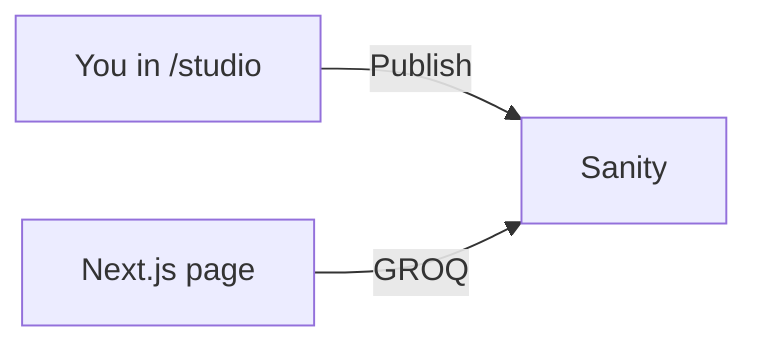

# Start the project

## What you are doing

You are starting the Next.js app in this folder and connecting it to Sanity. The website is Next.js. The writing lives in the Sanity project **saylni-blog**. The project ID is `o2zj2owv`. The dataset is `production`.

You are not creating a second website for the editor. Studio runs inside this app at `/studio`.

## Basic idea



**Save** keeps a private draft. **Publish** is what the website can show.

## What you need installed

- Node.js 20 or newer, which includes npm
- A code editor
- A browser
- A Sanity account that can open **saylni-blog**

Check Node:

```bash
node -v
npm -v
```

## Install the app

In the project folder, on a new computer:

```bash
npm install
npm run dev
```

Open `http://localhost:3000`.

Leave that terminal open. To stop the server, press Ctrl+C.

Other commands:

```bash
npm run lint
npm run build
```

`npm run build` checks that the site can be built for production. `npm start` serves that build, but only after `npm run build`.

## Install Sanity in this project

Sanity is already listed in `package.json`. `npm install` downloads it. If you were adding it to a new Next.js app, the command is:

```bash
npm install sanity next-sanity styled-components @sanity/image-url @portabletext/react
```

| Package | Why it is here |
| --- | --- |
| `sanity` | The Studio editor |
| `next-sanity` | Puts Studio in Next.js and fetches content |
| `styled-components` | Studio needs this to draw its screens |
| `@sanity/image-url` | Turns a Sanity image into a picture address |
| `@portabletext/react` | Turns the article body into paragraphs and headings |

## Environment file

`.env.local` tells Next.js which Sanity project to use. For this class it is:

```text
NEXT_PUBLIC_SANITY_PROJECT_ID=o2zj2owv
NEXT_PUBLIC_SANITY_DATASET=production
NEXT_PUBLIC_SANITY_API_VERSION=2026-10-17
NEXT_PUBLIC_SITE_URL=http://localhost:3000
```

If the file is missing, copy `.env.example` to `.env.local`. Restart `npm run dev` after you edit it. Next.js reads that file only when the server starts.

`src/sanity/env.js` reads those variables. The project ID is public. It is not a password. Do not put a write token in a `NEXT_PUBLIC_` variable. This blog only reads published posts, so it does not need a token.

Use the ID `o2zj2owv`. Do not put the project name `saylni-blog` in `NEXT_PUBLIC_SANITY_PROJECT_ID`.

## Folder structure

```text
headless/
  .env.local                         project ID and dataset
  sanity.config.js                   Studio settings
  sanity.cli.js                      Sanity command-line settings
  src/
    app/
      (site)/page.js                 home page        /
      (site)/blog/page.js            post list        /blog
      (site)/blog/[slug]/page.js     one post         /blog/my-new-post
      (site)/about/page.js           about page       /about
      (site)/layout.js               header and footer
      studio/[[...tool]]/page.js     editor route     /studio
      studio/[[...tool]]/studio.js   mounts Studio
    sanity/
      env.js                         reads the project ID
      structure.js                   Studio sidebar
      schemas/post.js                the post form
      schemas/index.js               list of forms
      lib/client.js                  connection to Sanity
      lib/queries.js                 GROQ questions
      lib/posts.js                   functions the pages call
      lib/image.js                   cover image addresses
    lib/site.js                      site name and menu
    components/blog/                 cards and article body
```

Two folder rules:

- `(site)` does not appear in the URL. It groups the public pages so they share a header and footer.
- `[slug]` means any post address. `[[...tool]]` lets Studio open its own pages under `/studio`.

The app uses the Next.js App Router and JavaScript, not TypeScript. Tailwind CSS 4 styles the pages. shadcn/ui components in `src/components/ui/` are used for the button, menu, and theme control.

## How Next.js connects to Sanity

There are four connections. They all use the same project ID.

1. **Settings.** `.env.local` → `src/sanity/env.js`.
2. **Reading posts.** A page calls `getPosts()` in `src/sanity/lib/posts.js`. That runs the GROQ in `src/sanity/lib/queries.js` through the client in `src/sanity/lib/client.js`. The home page does this:

```js
const result = await getPosts();
```

3. **Studio.** `sanity.config.js` sets `basePath: "/studio"`, the dataset, and the post schema. `src/app/studio/[[...tool]]/studio.js` renders it with `NextStudio`. Open `http://localhost:3000/studio` and sign in.
4. **The form.** `src/sanity/schemas/post.js` is the only schema: title, slug, short summary, cover image, date, and body.

On your computer, a refresh after Publish shows the new post. Lesson 3 explains the CORS screen if Studio says it is not connected. Add the origin `http://localhost:3000` and allow credentials. Do not put `/studio` on the end of that origin.

## Mistakes

- Looking for `src/app/page.js`. The home page is `src/app/(site)/page.js`.
- Adding TypeScript files. This class stays in `.js` and `.jsx`.
- Forgetting `npm install` on a new computer.
- Changing `.env.local` and not restarting `npm run dev`.
- Typing `saylni-blog` where the project ID `o2zj2owv` belongs.

## Try this

Change the tagline in `src/lib/site.js`, save, and refresh the home page. Put the old sentence back when you are done. Then open `/studio` and confirm you reach the editor or the Sanity login.

## Questions

- Which command starts the website?
- Which package mounts Studio inside Next.js?
- Why does `(site)` not show up in the address bar?
- What should you do after changing `.env.local`?
- Which file is the post form?

## You can say you learned it when

You can start the site, name the home page file, find the Studio route, and explain how a page reaches Sanity: page → `posts.js` → `queries.js` → `client.js`.
