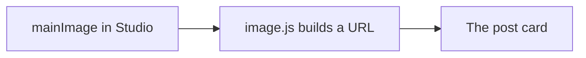

# Images and the article body

## The cover image

The cover is the `mainImage` field on the post. Studio stores a reference to the picture, plus a hotspot and crop, plus alternative text.

The website does not print the raw Sanity object. `src/sanity/lib/image.js` uses `@sanity/image-url` to build a real picture address on `cdn.sanity.io`. The helper respects the crop and hotspot, asks for a modern format, and sets the quality to 75.

`src/components/sanity-image.jsx` uses Next.js `Image` with that address. If there is no picture, the card simply has no cover. That is fine.

`next.config.mjs` allows images from `cdn.sanity.io`. Without that setting, Next.js refuses to load them.

## Alternative text

The alt text is a sentence about the picture, for people who cannot see it and for search engines. “Photo” is not useful. “Students writing at a table” is useful. If the picture is only decoration, the component can leave the alt empty.

## The body is not HTML

The body is Portable Text. Sanity stores an array of blocks. A paragraph looks like a block with `style: "normal"`. A heading in this schema uses `style: "h2"`. Bold and italic are marks. A link is an annotation with an `href`. A picture inside the article is an image block.

`src/components/article-body.jsx` uses `@portabletext/react` to turn those blocks into React elements: paragraphs, `h2` headings, links, and images.

## Why we do not use `dangerouslySetInnerHTML`

The body is data, not a string of HTML from an editor. React builds the tags. That avoids pasting unsafe HTML into the page.

## Data flow

## Mistakes

- Uploading a picture and forgetting the alternative text.
- Expecting the body to be one HTML string you can paste.
- Adding a new body style in the schema and forgetting to handle it in `article-body.jsx`. The text can still appear, but the new style will look like a normal paragraph until you map it.

## Try this

Publish a post with a cover image and one heading inside the body. Open the post page and check that the heading is larger than the paragraph under it.

## Questions

- What does the image URL helper do?
- Why is the body stored as blocks?
- Where do you allow `cdn.sanity.io`?

## You can say you learned it when

You can explain how a Studio image becomes a picture on the page, and how a body block becomes a heading or a paragraph.
